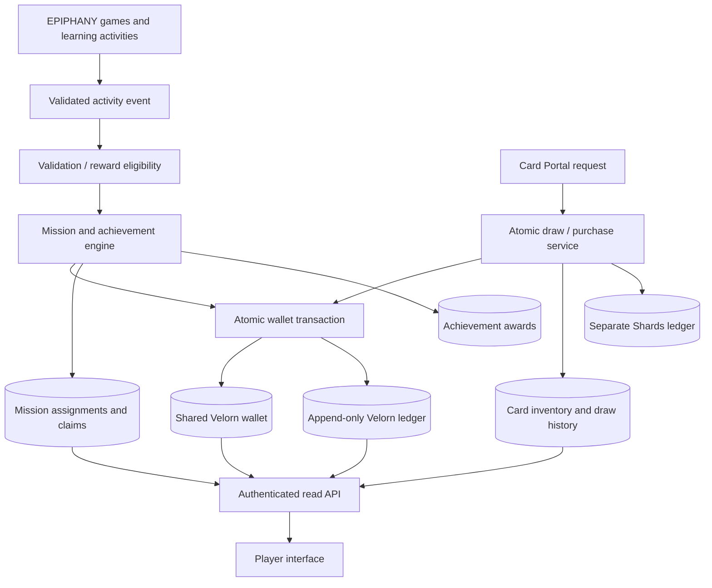

# Velorn Economy — Technical Architecture

> **Status (verified 2026-11-11):** Phase 1 wallet/ledger and Phase 2 event/claim-record foundations are deployed. Odd One Out has authenticated and guest server validators; the answer-bearing bank is private to the Edge Functions and absent from public PWA assets. Guest sessions are online-validated but intentionally create no trusted economy event or wallet. No mission predicate mapping, board generator, claim writer, player balance read, reward issuance, balance import, or economy activation is enabled.

## 1. Purpose and design constraints

This architecture turns the approved Velorn economy into a secure, auditable, cross-device system shared by EPIPHANY games and the Card Portal.

It must preserve these product decisions:

- One shared Velorn wallet per registered player across the whole website.
- Daily missions: four assigned, any three complete the board; 10 Velorn per rewarded mission and a 10 Velorn completion bonus; maximum 40 per day.
- Weekly missions: three assigned; 20 Velorn each and a 40 Velorn completion bonus; maximum 100 per week.
- Achievements are additional to recurring mission income and are awarded once per stable achievement/stage identity.
- Ordinary Card Portal draw: 50 Velorn; premium draw: 150 Velorn.
- The daily free pack is independent of Velorn and does not create a wallet transaction.
- XP and card Shards remain separate resources.
- Velorn does not expire, has no arbitrary balance ceiling, and cannot be purchased with real money or converted to cash.
- Games do not decide or write their own Velorn reward amounts.
- Replays, duplicate requests, retries, refreshes, and concurrent requests cannot create duplicate rewards or card purchases.

The existing economy values remain centrally configurable and versioned. Changing a reward or price must be a deliberate economy configuration change, not a one-off game-specific adjustment.

## 2. Verified current implementation

The following observations were checked against the repository's `main` branch and the connected Supabase project on 2026-11-10.

### Website and account architecture

- EPIPHANY is a static Vanilla-JS PWA; `package.json` has no application framework or build step.
- The browser loads Supabase JS v2 and a public publishable key from `supabase-config.js`. A publishable key is suitable for browser use; no service-role or secret key belongs in the client.
- `account.js` creates the Supabase client, handles Auth, and synchronizes the player's existing `player_progress` JSONB record.
- `player_progress` is a general learning-progress record. It is not an economy ledger and must not become the source of truth for Velorn.
- The account flow currently allows visitors to play without signing in and explains that their progress remains on that device until they create an account.

### Card Portal prototype

- `cards.js` explicitly describes the card system as local-only until secure cross-device transactions exist.
- Card state is stored in `localStorage` under `epiphany-card-prototype-v1`.
- The prototype currently calls the currency `tokens`, initializes a local starter balance, uses local achievement checks, and stores only a bounded local history.
- Its prototype prices, starter grants, developer test grant, local random draw, pity counter, duplicate-to-Shards conversion, and upgrade costs are not the approved Velorn economy. They must not be silently carried into the production economy.
- The current local card state is not a trustworthy source for granting Velorn or importing balances.

### Connected Supabase project

The project used by `supabase-config.js` is **EPIPHANY**, project ref `pqxkmtowialpjwehvuyb`, in `eu-west-1`, running PostgreSQL 17.11.

The inspected public schema currently includes:

- `player_progress`
- `player_profiles`
- `player_posts`
- `player_stories`
- `epiphany_telemetry`
- Asset Manager tables and card-image-view metadata

Velorn tables are intentionally held in the non-exposed `economy_private` schema, not the public schema. The project has one deployed Edge Function, `velorn-odd-one-out`, with JWT verification enabled.

The inspected RLS policies restrict `player_progress` reads and writes to the owning authenticated user. That is appropriate for learning progress, but it does not provide the transaction, reward-validation, or concurrency guarantees required by an economy.

Phase 0 schema reconciliation is complete. All nine hosted migration versions have matching repository files; three are explicitly labelled best-evidence reconstructions. A disposable local replay, schema assertions, and exact redacted catalog comparison passed. The Phase 1 migration is committed in `main`, clean-room GitHub Actions passed, and the migration has been applied to the hosted database as version `20261110183311`.

## 3. Target architecture at a glance

The system has four layers:

1. **Game and learning layer (browser):** continues to run the existing learning experiences and emits structured activity evidence. It never calculates or writes a Velorn amount.
2. **Validation and application API:** authenticated Supabase Edge Functions where game-specific validation or request orchestration is needed, plus a narrow set of authenticated database RPC entry points for atomic operations.
3. **Economy core (Postgres, non-exposed schema):** owns wallet balances, immutable ledgers, mission assignments, reward claims, achievement awards, Card Portal spending, and card draw state.
4. **Read model and UI:** fetches the signed-in player's balance, recent ledger entries, mission board, and card results through narrowly scoped read APIs. It does not maintain an authoritative local balance.

The database transaction is the final authority for credits and debits. An Edge Function may validate a game event, but it must not become a second wallet or maintain a separate balance.

## 4. Data model

All economy tables should live in a dedicated **non-exposed schema**, provisionally named `economy_private`. Names below describe logical responsibilities; they are not a migration or final SQL contract.

### 4.1 Wallet and Velorn ledger

**`wallets`**
- One row per registered player; unique `user_id` referencing `auth.users(id)`.
- `balance` as a non-negative `bigint` in whole Velorn units.
- `created_at`, `updated_at`, and an optional monotonically increasing version for diagnostics.
- Created lazily on the first eligible wallet operation, not by trusting a browser-supplied starting balance.
- No arbitrary maximum balance and no expiry field.

**`wallet_ledger`**
- Append-only record of every Velorn credit and debit.
- Suggested fields: immutable entry ID, user ID, signed amount, resulting balance, transaction type, source type, stable source reference, idempotency key, economy configuration version, concise reason/metadata, and server timestamp.
- Positive amounts are credits; negative amounts are debits. Zero-value entries are rejected.
- Unique constraint on `(user_id, idempotency_key)`; a stable source reference should also be unique for reward types that must only pay once.
- Index by `(user_id, created_at DESC, id)` for wallet history and by source reference for support/reconciliation.
- No client UPDATE or DELETE. Corrections are compensating ledger entries with a reason and reference to the original entry; the original record remains intact.

The wallet balance is a fast current-balance projection. The ledger is the audit trail and reconciliation source. Each balance change and its ledger entry must commit or roll back together in one database transaction.

### 4.2 Economy configuration

**`economy_config_versions`**
- Immutable, versioned configuration snapshots for reward amounts, Card Portal prices, mission bonus rules, period policy, and feature activation.
- Each ledger entry and reward assignment records the version used.
- New versions are inserted rather than overwriting history.
- The approved initial values are 50 / 150 Velorn for ordinary / premium draws, 10 per daily mission plus 10 daily completion bonus, and 20 per weekly mission plus 40 weekly completion bonus.
- Configuration activation is a controlled administrative operation, not a browser setting.

Card rarity weights, pity guarantees, premium pack contents, and exact draw odds are separate Card Portal rules and remain unresolved until specified. A price must not be treated as approval of any particular odds or guarantee.

### 4.3 Normalized activity events

**`activity_events`**
- Stores the minimum normalized evidence needed by missions and achievements.
- Suggested fields: event ID, user ID, source game/system, stable activity ID, event type, server-issued session reference where applicable, occurred-at and received-at timestamps, validation status/version, and a small bounded metadata object.
- Unique source-event identity prevents the same event being ingested twice.
- Do not store answer text, story text, email, profile data, or unrelated personal information in economy events.
- Events are immutable after acceptance; a correction is represented by a separate administrative/validation record.

A normalized event contract should support multiple game designs. It must not assume every game has questions, rounds, levels, scores, or a fixed session structure.

### 4.4 Daily and weekly missions

**`mission_templates` / versioned template definitions**
- Stable template ID, version, mission category, eligibility rules, objective schema, reward amount, and activation window.
- The bank contains the approved daily and weekly templates already documented in `WORLD_CURRENCY_VELORN.md`.
- Templates describe outcomes, not UI copy alone. A template cannot be issued if its objective cannot be evaluated for that player.

**`mission_boards`**
- One immutable board assignment per user and period.
- Stores user ID, period type, period start/end, timezone used, template-bank/config version, assignment timestamp, and board state.
- Unique key: `(user_id, period_type, period_start)`. Reloading, opening another device, or retrying an API request returns the same board.

**`mission_assignments`**
- Individual mission slots attached to a board.
- Stores stable assignment ID, template ID/version, objective parameters snapshot, reward snapshot, progress state, progress value, completion timestamp, and replacement lineage if a mission was legitimately replaced.
- Daily board: four slots, any three rewarded completions are enough for the full 40 Velorn budget. The fourth is optional and must not increase the daily cap.
- Weekly board: three slots, each worth 20 Velorn; completion of all three creates one 40 Velorn bonus claim.

**`mission_reward_claims`**
- Records each paid mission and board bonus.
- Unique reward identity per user and assignment/board bonus.
- Stores the resulting ledger entry ID and configuration version.
- A mission cannot be paid twice even if its event is received repeatedly or multiple requests race.

Progress is accumulated from accepted activity events. One event may advance more than one mission only when it genuinely satisfies distinct objectives; each assignment still has its own one-time claim.

### 4.5 Achievements

**`achievement_awards`**
- One row per paid achievement milestone.
- Stable `achievement_id` and optional `stage_id`, qualifying event/reference, reward amount, config version, ledger entry ID, and award timestamp.
- Unique key: `(user_id, achievement_id, stage_id)` (with a canonical non-null representation for achievements without stages).
- Achievement checks are based on distinct validated activity or progression milestones, never browser-provided arbitrary reward values.
- Permanent achievements pay once. Multi-stage achievements pay only once for each explicitly defined stage.
- Achievement rewards are additional to daily and weekly mission budgets.

### 4.6 Card Portal and inventory

**`card_portal_state`**
- Per-user draw state, including the pity counter and active ruleset version.
- Pity state changes only as part of a successfully committed draw.
- The exact pity threshold and which draw types count toward it remain an explicit product decision.

**`card_draws` and `card_draw_items`**
- Immutable record of each paid or free draw request, request idempotency key, draw type, pack/catalog/ruleset version, price, result card IDs, rarity result, and timestamp.
- A unique request key ensures a retry returns the original result rather than charging or rolling again.
- The server chooses the result using a server-side random source. The browser must never send a chosen card, rarity, random seed, or pity result as authoritative input.

**`player_card_inventory`**
- Durable ownership by user and stable card ID, with acquisition metadata and any approved card progression fields.
- A first copy creates ownership. A duplicate follows the approved Shards conversion rule; it does not create duplicate Velorn.
- Inventory updates, duplicate conversion, pity update, draw record, and Velorn debit must be committed atomically.

The card catalog remains content data with stable IDs. The server-side active catalog/ruleset must be versioned and must reject inactive or unknown card IDs. Artwork URLs and image assets remain in the existing Asset Manager/Storage system; the economy should store card IDs, not duplicate art files.

### 4.7 Shards remain separate

Shards must not be stored in the Velorn wallet or Velorn ledger. If the current local prototype's Shards feature is retained, move its authoritative balance and changes to a separate card-resource ledger (or equivalent append-only subsystem) before cross-device card upgrades are enabled.

The existing prototype's duplicate conversion and upgrade values are not silently adopted as final economy policy. Their approved production values and rules must be confirmed in the Card Portal specification.

## 5. Transaction and API boundaries

### 5.1 Allowed client operations

The signed-in browser may:
- Read its own wallet balance and recent ledger history.
- Read its own daily/weekly mission board and progress.
- Submit a game activity result for validation.
- Request a paid draw with a pack/type and a client-generated idempotency UUID.
- Claim the daily free pack through a separate free-claim operation.
- Read its own inventory and draw history.

The browser may not:
- Insert, update, or delete wallet or ledger rows.
- Choose a reward amount or achievement reward.
- Mark a mission complete by sending a progress total.
- Choose the card or rarity returned by a draw.
- update pity, wallet balance, Shards balance, or reward-claim state directly.
- use a service-role or secret key.

### 5.2 Narrow server entry points

Use a small API surface rather than exposing tables as a general-purpose economy API. Proposed operations:

- `get_my_wallet()`
- `get_my_wallet_ledger(cursor, limit)`
- `get_my_mission_board(period)`
- `submit_activity_event(event_payload)` (or an Edge Function where game-specific validation is required)
- `request_card_draw(draw_type, pack_id, idempotency_key)`
- `claim_daily_free_pack(idempotency_key)`
- `get_my_card_inventory(cursor)`
- `get_my_card_history(cursor, limit)`

Names are illustrative, not final function signatures.

Atomic database routines perform wallet credit/debit and related writes. Phase 1 uses narrow public RPC wrappers with `SECURITY INVOKER`, executable only by `service_role`; their implementations live in the non-exposed `economy_private` schema, use a fixed empty `search_path`, schema-qualify referenced objects, and independently require the trusted `service_role` JWT claim. The service role has schema usage and exact function execution rights but no direct table privileges. No player or browser role can call these wallet routines. Game validators authenticate the caller and derive the player ID from the verified Auth identity; never trust a client-supplied user ID. Do not create a broadly callable `SECURITY DEFINER` function in the exposed schema.

Where an Edge Function is used, it must authenticate the request with the user's verified Supabase identity. The service-role key may exist only in server-side function secrets, never in the PWA. The Edge Function is not allowed to accept a user ID or reward amount as proof of authority.

### 5.3 Atomic wallet credit

For a validated reward:
1. Resolve the user from the verified Auth context; never trust a submitted `user_id`.
2. Resolve the reward from the server-owned assignment/achievement/configuration.
3. Validate event identity, eligibility, period, and one-time claim status.
4. Lock or safely create the player's wallet row.
5. Insert the unique claim and ledger entry, then update the cached balance in the same transaction.
6. Return the committed balance and ledger reference.
7. If the same request is retried, return the existing result without another credit.

The amount comes from the server-side template/configuration snapshot, never from the request body.

### 5.4 Atomic paid card draw

For a paid draw:
1. Authenticate the user and validate the pack and active ruleset.
2. Resolve price and draw count from server configuration.
3. Lock the user's wallet and Card Portal state in a consistent lock order.
4. Check sufficient balance; a conditional debit must never allow a negative balance.
5. Generate the card result on the server.
6. Write the Velorn debit ledger entry, draw record/items, inventory changes, duplicate-to-Shards changes, and pity update in the same transaction.
7. Commit and return the stored result.

If any step fails, the entire transaction rolls back. A network retry with the same idempotency key returns the first committed result. A new key represents a new draw request.

The free daily pack uses a separate unique user/period claim and does not debit Velorn. Its interaction with pity and the Shards system must follow the separately approved Card Portal rules.

## 6. Security, authorization, and concurrency

- Keep all economy tables in a non-exposed schema; do not grant direct table access to `anon` or `authenticated`.
- Enable RLS on every table as defense in depth, even in the private schema. Policies must match the intended service access model.
- The only player-facing identity is `auth.uid()`. Never authorize using editable `user_metadata`; any staff permission must be stored in trusted server-managed app metadata or another protected authorization table.
- Revoke default PUBLIC function execution and explicitly grant only the Phase 1 server-side wrapper execution rights to `service_role`; player-facing grants require a separate reviewed API design.
- No service-role key in HTML, JavaScript, localStorage, or client configuration.
- Use foreign keys, unique constraints, CHECK constraints, and non-null columns to enforce invariants in the database, not only in JavaScript.
- Use `bigint` for whole-number currency; no floating-point currency arithmetic.
- Every reward/debit uses an idempotency key and database uniqueness constraint. Client-side button disabling is only a UX aid.
- Serialize same-user balance changes with a wallet-row lock or equivalent conditional update. Always lock related resources in a consistent order (wallet before Card Portal state/inventory) to reduce deadlocks.
- A debit is accepted only if the same atomic statement/transaction confirms sufficient funds.
- Ledger rows are append-only. Refunds and corrections create compensating entries; they do not rewrite history.
- Bound JSON metadata size and validate allowed event types/source identifiers.
- Add rate limits and abuse monitoring at event-ingestion and draw-request boundaries.
- Keep support/admin adjustments separate, reasoned, permission-checked, and auditable.

Supabase's current guidance distinguishes Data API grants from RLS. Also, the 2026 change to automatic Data API exposure means new public-schema tables may not be exposed by default. The economy must not depend on implicit exposure: keep core tables private and explicitly grant only the narrow API functions that are intended to be callable. See the [Supabase Data API exposure change](https://supabase.com/changelog/45329-breaking-change-tables-not-exposed-to-data-and-graphql-api-automatically).

## 7. Activity validation and anti-farming

A client-side game is not a trusted authority. A user can inspect or modify browser JavaScript and fabricate a request. Therefore, an event containing only `completed: true`, a claimed score, or a claimed reward is not sufficient evidence.

Use a validation contract with:
- Stable source game and activity IDs.
- Server-issued session or objective reference where applicable.
- Stable event/request ID and sequence number.
- Event type from a server allowlist.
- Server receive timestamp and validated period.
- Minimal result evidence required by that game.
- Validation version and outcome.

Validation levels:
1. **Server-verifiable:** the server can independently verify the qualifying result. Eligible for the full configured reward.
2. **Constrained client result:** the server can check a server-issued session, uniqueness, objective structure, timing, and rate limits, but cannot fully verify every answer. Reward eligibility must be explicitly limited and documented for that activity.
3. **Unverified/offline-only:** no reward or achievement claim is issued until acceptable server-verifiable evidence is available.

A signed session ticket can prevent forged session identities and replay, but it does not prove that a client-side answer was correct. Do not describe client-only outcomes as cheat-proof.

Anti-farming controls include:
- Distinct event IDs and unique accepted-event constraints.
- One claim per mission assignment and achievement milestone.
- No rewards for opening, restarting, refreshing, or replaying a completed activity.
- Activity-specific rate limits and minimum meaningful completion requirements.
- Repeated low-effort events cannot advance distinct-progress objectives.
- Monitoring for abnormal event frequency, repeated payloads, and impossible timing.
- A clear validation failure path that does not debit the player or destroy legitimate learning progress.

## 8. Periods, timezones, and mission assignment stability

- Use the player's saved account timezone when valid; otherwise use an explicit UTC fallback.
- Store timestamps in UTC and store the timezone and period start/end used for each assignment.
- Daily and weekly periods are calculated server-side, including daylight-saving transitions.
- Changing the account timezone must not create a second board or duplicate a claim for an already-issued period.
- A board is created once per user and period and remains stable across refreshes and devices.
- A mission can be replaced only for genuine ineligibility, unavailable content, or a system defect. Preserve legitimate progress where applicable and record the replacement lineage.
- Never lower the reward or silently replace an eligible mission because the player has not completed it.
- If the eligible template pool cannot produce a fair board with at least three completable daily tasks, do not fabricate tasks or reduce the budget. Log an assignment issue and provide safe alternatives.

## 9. Guest and offline behavior

The existing site supports guest learning, while the proposed wallet is account-bound and cross-device. The recommended boundary is:

- Guests may continue using learning experiences and local progress as they do today.
- A durable Velorn wallet and server-paid rewards require a verified authenticated account.
- Guest-local counters must never be presented as a real wallet balance.
- Do not automatically convert legacy local token values or unverified guest reward events into Velorn at registration.
- Offline learning may continue. Velorn claims are accepted only when the server can validate the event and its period. A previously server-issued, still-valid event ticket may be queued if its validation rules explicitly permit it; arbitrary offline client events are not retroactively rewarded.

**Product decision still required:** whether verified account creation should ever grant a one-time welcome balance or allow any narrowly defined guest-to-account reward conversion. The safe default is no automatic legacy-balance import and no unverified backfill.

## 10. Migration and rollout plan

Do not implement all components in one production migration. The economy is a financial-like integrity boundary and should be introduced behind a disabled feature flag.

### Phase 0 — schema and migration reconciliation — COMPLETE
- Reconcile the live schema, policies, grants, functions, and hosted migration history with repository SQL.
- Establish the local-only legacy foundation and redacted live catalog reference.
- Replay all nine hosted migrations in a disposable Supabase stack and compare the resulting catalog exactly.
- Preserve production data and leave the hosted database unchanged.

### Phase 1 — private wallet and ledger foundation — DEPLOYED AND VERIFIED
- Create `economy_private`, immutable configuration versions, disabled economy settings, one-wallet-per-account storage, and an append-only signed ledger.
- Add RLS and FORCE RLS, no direct table grants, service-role-only RPC wrappers, constraints, indexes, idempotency, and atomic wallet-row locking.
- Add snapshot and reconciliation routines.
- Keep `economy_enabled = false`; wallets are lazy-created only for an accepted trusted transaction. No automatic grants, player-facing balance, browser integration, or Card Portal behavior.
- The clean-room Phase 1 assertions passed. The hosted migration is applied; post-deployment checks confirmed the disabled setting, empty wallets/ledger, private schema permissions, forced RLS, append-only triggers, and service-role-only RPC execution.

### Phase 2 — normalized events and reward-claim foundation — DEPLOYED FOUNDATION; CLAIMS DISABLED
- The additive private-schema foundation is deployed on hosted Supabase.
- Seven private tables model normalized activity evidence, versioned mission/achievement definitions, stable mission boards and assignments, mission claims, and achievement awards.
- A service-role-only, idempotent validated-event ingestion RPC accepts evidence only from trusted server validators; it does not validate browser claims itself.
- Mission templates and achievement definitions remain inactive/unmapped. No boards, assignments, claims, or awards have been created.
- Board generation, timezone/reset policy, and atomic claim writers remain required before rewards can be paid. See [VELORN-PHASE-2-EVENTS-AND-CLAIMS.md](VELORN-PHASE-2-EVENTS-AND-CLAIMS.md).
- Keep production reward issuance disabled; do not enable any template until its validator mapping is verified.

### Phase 3 — trusted game validators — IN PROGRESS
- Phase 3A inventory and trust contract are documented in [VELORN-PHASE-3-TRUSTED-GAME-VALIDATORS.md](VELORN-PHASE-3-TRUSTED-GAME-VALIDATORS.md).
- The authenticated server-owned Odd One Out validator is deployed through `velorn-odd-one-out`; guest sessions use the separate `velorn-odd-one-out-guest` endpoint with a random 256-bit bearer token and server-stored token hash.
- Both deployed functions match their three repository source files byte-for-byte (authenticated function version 7; guest function version 5). Both use the same rotated server-only question bank; the public PWA does not contain or cache the answer-bearing bank.
- Authenticated sessions enforce ownership, ordered answers, expiry, row locking, replay rejection, pacing and per-user start limits, and atomic validated-event creation. Guest sessions enforce token possession, ordered answers, expiry, replay rejection, IP-based start limits and pacing.
- Guest completions intentionally do not write trusted activity events, wallets, claims, awards or Velorn. This preserves the account-bound wallet boundary; guest-local prototype counters are not Velorn.
- The former public answer-key blocker has been removed. Odd One Out remains unmapped and cannot earn rewards until its mission predicates and the atomic claim service are reviewed and implemented. See [VELORN-PHASE-3C-ODD-ONE-OUT-VALIDATOR.md](VELORN-PHASE-3C-ODD-ONE-OUT-VALIDATOR.md).
- Expand to other games only after their server-owned evidence and anti-abuse rules are independently reviewed. Keep all mission/achievement mappings inactive.

### Phase 4 — Card Portal transactions
- Implement server-side draw rules, wallet debit, draw history, inventory, pity, and separate Shards transactions.
- Resolve and document pack odds, pity rules, free-pack interaction, duplicate conversion, and upgrade costs before activation.
- Build a one-time reconciliation/import plan for existing local card ownership only if it can be safely verified; never import local Velorn balances.

### Phase 5 — client integration and controlled rollout
- Replace the prototype token display and local spend path with server reads and atomic requests.
- Remove local reward grants, starter-token grants, developer token grants, and browser-side reward authority.
- Preserve offline learning and the separate XP system.
- Enable for a controlled test cohort only after all security and economy acceptance criteria pass; monitor ledger reconciliation, duplicate claims, validation rejection, transaction latency, and mission completion rates.

Each phase needs its own migration, tests, rollback plan, and documented verification. A deployed validator does not authorize mission assignment or reward issuance. Do not expose player balances or enable the economy until the later activation gates pass.

## 11. Required acceptance tests

### Wallet and ledger
- New authenticated user gets one wallet, not multiple wallets across games.
- No negative balance under concurrent debit attempts.
- Every balance change has exactly one ledger entry in the same transaction.
- Duplicate idempotency key returns the original transaction.
- Two concurrent identical reward requests produce one credit.
- Corrections create compensating entries and preserve original history.
- Ledger history is correctly ordered and paginated.

### Missions and achievements
- Four daily tasks are issued; any three earn 40 Velorn; the fourth cannot exceed the cap.
- Three weekly tasks plus the weekly bonus total 100 Velorn.
- Daily and weekly periods handle UTC fallback, timezone changes, and daylight-saving transitions without duplicate boards or claims.
- A mission cannot be claimed twice across devices or concurrent requests.
- Achievement and stage IDs pay once; distinct case IDs remain independently eligible.
- Unavailable tasks are replaced without reducing the player's approved reward opportunity.
- Duplicate, replayed, malformed, and unverified events do not grant currency.

### Card Portal
- Ordinary and premium draws debit exactly 50 and 150 Velorn.
- Insufficient balance leaves wallet, inventory, pity, Shards, and draw history unchanged.
- A retried draw request returns the same committed cards and does not charge twice.
- A failed draw transaction leaves no partial debit or inventory change.
- The free daily pack can be claimed once per configured period and never debits Velorn.
- Duplicate conversion and Shards updates are atomic and independent from the Velorn ledger.
- Server-side catalog/ruleset versions are recorded for every draw.

### Security and operations
- Anonymous users cannot read or mutate private economy tables.
- Authenticated users cannot read or mutate another player's wallet, ledger, missions, claims, or inventory.
- Client-supplied user IDs, reward amounts, prices, card IDs, rarities, and pity values cannot override server decisions.
- No service-role key appears in client assets.
- RLS, function grants, schema exposure, and Supabase security/performance advisors are reviewed before activation.
- A reconciliation query can compare wallet balances with the sum of ledger entries and identify any mismatch.

## 12. Open decisions before production activation

These decisions do not block building the disabled Phase 1 wallet/ledger foundation. They must remain configurable or be explicitly resolved before reward issuance, draws, imports, or user-facing activation:

1. Whether account creation grants any welcome Velorn, and whether any verified guest progress can be converted.
2. Card Portal pack composition, rarity weights, exact odds, pity threshold, and whether free draws advance pity.
3. Production duplicate-to-Shards conversion and card upgrade costs.
4. Whether all game completion events can be server-verified or which activities need constrained reward eligibility.
5. Account timezone setting UX and the exact daily/weekly reset boundary.
6. Whether the initial launch enables all mission templates or a smaller validated subset.
7. Whether existing local card ownership can be safely imported, and what the player-facing migration notice should say.

No value in this list should be silently inferred from the old local token prototype.

## 13. Implementation boundary

Phase 1 and Phase 2 foundations are deployed and verified on the hosted Supabase project. Phase 3's first Odd One Out validator is also deployed. A rollback-only PostgreSQL smoke test exercised session creation, correct/incorrect answer evaluation, completion-event creation, and replay rejection; the transaction was rolled back and a follow-up read confirmed no test user, session, or event persisted. The hosted validator migration version is `20261110192426`.

The validator created no wallet or ledger entry. No user balances, local token balances, card inventory, or Shards have been imported. Hosted-state verification on 2026-11-11 found zero wallets, ledger entries, activity events, validator sessions, mission boards, assignments, claims, or achievement awards; `economy_enabled = false`; all 11 mission templates and 10 achievement definitions remain non-assignable. The authenticated and guest Edge Function deployments were compared byte-for-byte with `main`. The public answer-key exposure has been resolved; reward issuance remains blocked by the unimplemented predicate mapping, board service, timezone policy, and atomic claim service.

## 14. Phase 0 schema reconciliation

The Supabase inventory and migration comparison are documented in [VELORN-PHASE-0-SCHEMA-RECONCILIATION.md](VELORN-PHASE-0-SCHEMA-RECONCILIATION.md). All nine hosted application migration versions now have matching files in the repository. The three previously missing files are best-evidence reconstructions, explicitly labelled as such rather than presented as original historical SQL. A local-only legacy foundation now captures the manually created tables and policies, and the root-level SQL entry points are archived as do-not-run pointers. The automated clean-room workflow uses Supabase CLI 3.1.0 and asserts the nine-table schema, migration history, RLS policies, Storage policies and bucket limits.

**Implementation gate:** Phase 0, Phase 1, and the Phase 2 database foundation are deployed and verified. Phase 3 validator work may continue while the economy remains disabled. Do not activate rewards, draws, or user-facing balances until validator eligibility, mission predicates, timezone policy, claim atomicity, and the open decisions in Section 12 are explicitly resolved.

## 15. Guest/account wallet boundary — verified 2026-11-11

- The economy's durable wallet identity is the verified Supabase Auth user ID. The server does not create a wallet from a client-supplied identifier.
- Guest play is supported online through a distinct session-token validator, but guests do not have a durable Velorn wallet and their game completions do not enter the trusted activity-event stream.
- Signing out switches the Card Portal prototype to its isolated guest storage namespace; signing in switches to a namespace scoped to that verified user ID. The ambiguous legacy shared local token store is migrated only when the independent progress-owner marker matches the signed-in user; otherwise it stays quarantined.
- These local namespaces are a compatibility boundary for the old prototype only. They are not authoritative currency storage and are user-editable. Phase 5 must remove local token balances, starter grants and browser-side spending before the Card Portal can display or transact real Velorn.
- No guest-to-account balance conversion or legacy token import is permitted by default. Any future welcome grant or conversion requires an explicit product decision and a separate server-authoritative migration design.
